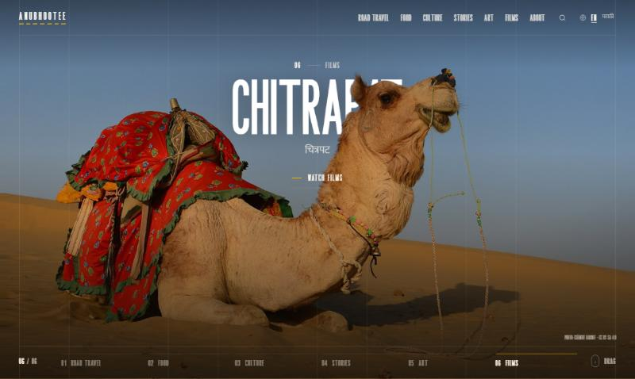

# Anubhootee (अनुभूती)

Stories, food, culture and road travel from India, in English and मराठी.



## What's in this repository

| Folder | What it is |
|---|---|
| [`anubhootee-web/`](anubhootee-web/) | **The website.** Laravel 13 + Filament admin, Blade, Tailwind CSS 4, Alpine.js. Full-screen chapter showcase with a WebGL transition and an iPhone-style depth effect, stories, sections, search, contact form, newsletter, English + Marathi. See its [README](anubhootee-web/README.md). |
| [`Anubhootee/theme/`](Anubhootee/theme/) | An earlier WordPress block theme for the same design, with a WordPress Playground test setup (`theme/dev/`). |
| [`Anubhootee/design/`](Anubhootee/design/) | The original static HTML mockups and logo options. |
| [`Anubhootee/PLAN.md`](Anubhootee/PLAN.md) | The site plan. |
| [`docs/screenshots/`](docs/screenshots/) | Screenshots. |

## Quick start (website)

Needs PHP 8.4, Composer and Node.js.

```bash
cd anubhootee-web
composer install
npm install
cp .env.example .env
php artisan key:generate
php artisan migrate --seed
php artisan storage:link
npm run build
php artisan serve
```

Open http://127.0.0.1:8000 (admin at `/admin`; set `ADMIN_EMAIL` / `ADMIN_PASSWORD` in `.env` before seeding).

## Fonts

The headline font (**New York**) and the other display fonts on the `/brand` page are paid, licensed fonts, so their files are **not** in this repository. Put your licensed copies in `anubhootee-web/public/fonts/brand/` with these names:

```
new-york-new.otf  new-york-york.otf  raga.woff2
contrue-sans.woff2  contrue-sans-blur.woff2  contrue-blackletter.woff2  contrue-blackletter-blur.woff2
duobles-glomaflow.woff  duobles-glomaflow-handwritten.woff
bunga-mekar-display.otf  bunga-mekar-script.otf
ashanti-spirit-regular.otf  ashanti-spirit-bold.otf
```

Without them the site falls back to Inter. Inter, Mukta, Tiro Devanagari Marathi and Newsreader are free Google Fonts.

## Credits

Demo photos are from Wikimedia Commons, CC BY-SA 4.0; see `anubhootee-web/database/seeders/images/CREDITS.md`. Replace them with your own before launch.
